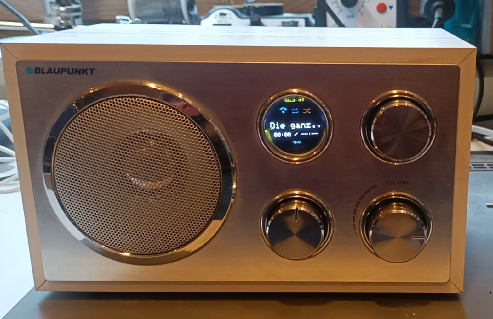
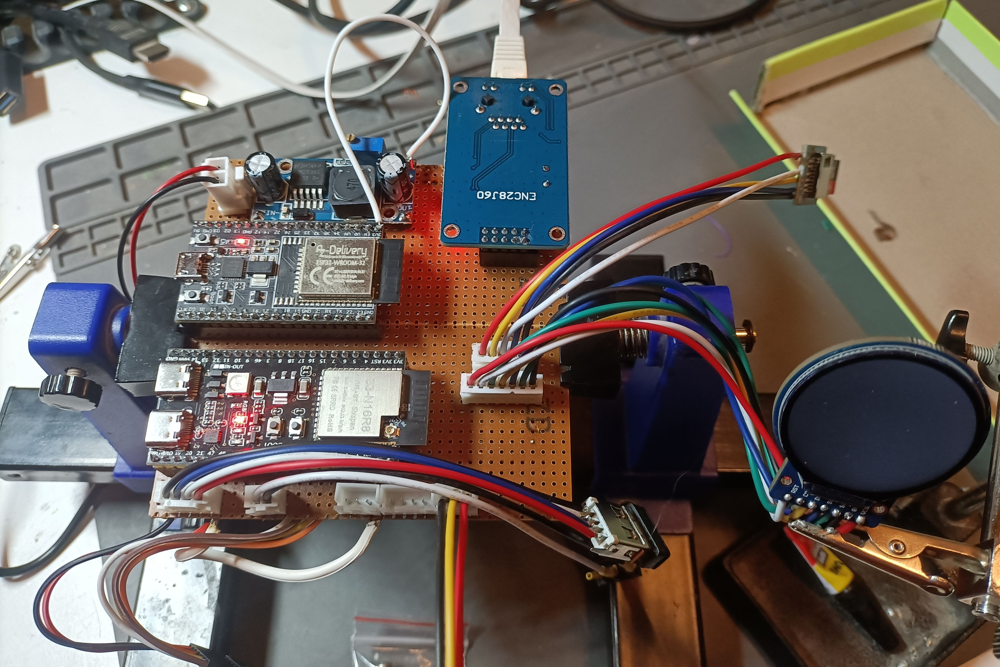
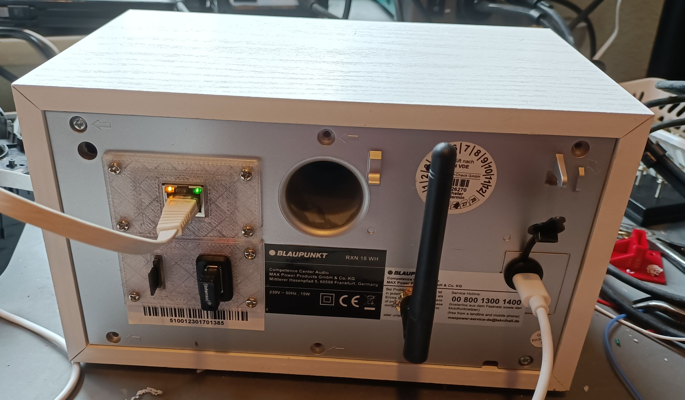

# Nerd-Wave v1.0.0

Ein selbstgebauter Audioplayer auf Basis eines **ESP32-S3 N16R8** mit rundem GC9A01-Display. Nerd-Wave spielt Musik aus dem Netzwerk (NAS-API), von USB-Massenspeichern, SD-Karten und über Bluetooth ab. Bedienung über Drehencoder, Infrarotfernbedienung und Weboberfläche; MQTT-/Home-Assistant-Anbindung und konfigurierbare LED-Effekte.



> **Projektstatus:** Version 1.0.0. Diese README beschreibt die Anschlussbelegung des bereitgestellten Quellcodes. Versorgung und elektrische Eignung der jeweiligen Modulvarianten vor dem Einschalten anhand ihrer Datenblätter überprüfen. Die veröffentlichte Firmware trägt `v1.0.0`. Der zuletzt getestete Stand enthält auch die IR-Quellenwahltasten und die LED-Grundhelligkeit im Stopp-/Pause-Zustand.

## Hardware

| Bauteil / Modul | Aufgabe | Hinweis |
| --- | --- | --- |
| ESP32-S3 DevKitC-1 N16R8 (16 MB Flash, 8 MB PSRAM) | Hauptcontroller | ESP32-S3, nicht ESP32-WROOM |
| GC9A01, 240 × 240, SPI | Runddisplay | Firmware nutzt `tft.setRotation(0)` |
| ENC28J60 | Ethernet | Gemeinsamer SPI-Bus mit Display, separate CS-Leitung |
| MCP23017 | Encoder-/Tastereingänge | I²C-Adresse `0x20` |
| 2 Drehencoder mit Drucktaste | Navigation und Lautstärke | Am MCP23017-Port A |
| SD-Kartenmodul / SD-Slot | Lokale Musik | SD_MMC im 1-Bit-Modus, **3,3-V-Signale** |
| MAX98357A | I²S-Verstärker | Digitaler Audioeingang, Shutdown-Pin |
| ESP32-WROOM-32 (klassisches Bluetooth) | Bluetooth-A2DP-Empfänger | Separate Firmware unter `BT-WROOM32/` |
| USB-A-Buchse für USB-Host | USB-Massenspeicher | D− an GPIO19, D+ an GPIO20; VBUS 5 V separat versorgen |
| IR-Empfängermodul | Fernbedienung | Digitaler Signalausgang |
| WS2812B-kompatible LEDs | Lichteffekte | Geeignete separate Versorgung einplanen |
| Rastschalter | Geordnetes Ausschalten | Gegen GND, per Software aktivierbar |
| 5-V-USB-Netzteil | Hauptversorgung | Ausreichende Leistungsreserve insbesondere für USB, LEDs und Verstärker vorsehen |
| LM2596 Step-down-Modul | 3,3-V-Versorgung | Vor Anschluss auf 3,3 V einstellen und unter Last prüfen |

### Blick auf den Prototyp



## Anschlussbelegung am ESP32-S3

**Alle GPIO-Angaben beziehen sich auf den ESP32-S3, nicht auf die Nummern der Buchsenleisten.** Beide ESP32 und die angeschlossenen Module benötigen eine gemeinsame Masse, sofern ihre Stromversorgungen nicht galvanisch getrennt sind.

### Display GC9A01 und Ethernet ENC28J60 (gemeinsamer SPI-Bus)

| Signal | ESP32-S3 GPIO | Ziel |
| --- | ---: | --- |
| SPI MOSI | 11 | GC9A01 `SDA`/`DIN`; ENC28J60 `SI`/`MOSI` |
| SPI SCK | 12 | GC9A01 `SCL`/`CLK`; ENC28J60 `SCK` |
| SPI MISO | 13 | ENC28J60 `SO`/`MISO` |
| Display CS | 10 | GC9A01 `CS` |
| Display DC | 8 | GC9A01 `DC` |
| Display RESET | 7 | GC9A01 `RST` |
| Ethernet CS | 9 | ENC28J60 `CS` |
| Ethernet INT | 5 | ENC28J60 `INT` |
| Ethernet RESET | 4 | ENC28J60 `RST` |

Für das Display ist keine separate Backlight-Steuerleitung im Code vorgesehen. `SCL` auf SPI-Displays meint den SPI-Takt und ist **nicht** mit dem I²C-SCL des MCP23017 zu verbinden.

### MCP23017 und Drehencoder

| Signal | ESP32-S3 | Ziel |
| --- | ---: | --- |
| I²C SDA | GPIO 14 | MCP23017 `SDA` |
| I²C SCL | GPIO 15 | MCP23017 `SCL` |
| Adresse | `0x20` | Adresspins passend beschalten (typisch A0/A1/A2 = GND) |

| MCP23017-Port-A-Pin | Funktion |
| --- | --- |
| GPA0 | Navigation Encoder A |
| GPA1 | Navigation Encoder B |
| GPA2 | Navigation Drucktaster |
| GPA3 | Lautstärke Encoder A |
| GPA4 | Lautstärke Encoder B |
| GPA5 | Lautstärke Drucktaster |

Die Firmware aktiviert interne MCP23017-Pull-ups für Port A. Die Kontakte der Drehencoder/Taster werden gegen GND geschaltet. Beim MCP23017 die Versorgung, Reset- und Adresspins gemäß Datenblatt anschließen; `RESET` darf nicht undefiniert bleiben.

### SD-Karte, Audio, IR, LEDs und Power

| Funktion | ESP32-S3 GPIO | Ziel |
| --- | ---: | --- |
| SD_MMC CLK | 16 | SD `CLK` |
| SD_MMC CMD | 17 | SD `CMD` |
| SD_MMC D0 | 18 | SD `DAT0` |
| I²S Audio BCLK | 38 | MAX98357A `BCLK` |
| I²S Audio LRCLK/WS | 39 | MAX98357A `LRC`/`WS` |
| I²S Audio DATA | 40 | MAX98357A `DIN` |
| Verstärker Shutdown | 41 | MAX98357A `SD` |
| IR-Signal | 2 | IR-Empfänger `OUT` |
| WS2812B-Daten | 1 | LED-Streifen `DIN` |
| Rastschalter | 21 | Schalterkontakt nach GND |

Bei `GPIO41 = LOW` wird der MAX98357A abgeschaltet. Der Rastschalter ist **kein Netzschalter**, sondern signalisiert der Firmware den Wunsch zum sicheren Herunterfahren. `LOW` (geschlossen gegen GND) bedeutet EIN, `HIGH` AUS. Die Funktion muss in den Einstellungen aktiviert werden; nach Abschalten geht der ESP32 in Deep Sleep. Ein tatsächliches Trennen der Versorgung erfordert zusätzliche Hardware.

**SD-Hinweis:** Für SD_MMC muss die Beschaltung inklusive nötiger Pull-ups mit dem verwendeten SD-Slot kompatibel sein. Nicht mit einem SPI-only-SD-Modul gleichsetzen.

### Bluetooth: Verbindung zwischen ESP32-WROOM-32 und ESP32-S3

| Funktion | ESP32-WROOM-32 | ESP32-S3 |
| --- | ---: | ---: |
| UART Steuerdaten WROOM → S3 | TX GPIO17 | RX GPIO42 |
| UART Steuerdaten S3 → WROOM | RX GPIO16 | TX GPIO47 |
| I²S Bitclock | BCLK GPIO26 | BCLK GPIO3 |
| I²S Word Select | WS GPIO25 | WS GPIO6 |
| I²S Audio-Daten | DOUT GPIO22 | DIN GPIO46 |
| GND | GND | GND |

Auf dem WROOM32 läuft `BT-WROOM32/BT-WROOM32.ino`; dort ist der Bluetooth-A2DP-Empfänger implementiert. Der Haupt-S3 empfängt PCM-Audio über I²S und Steuer-/Statusmeldungen über UART bei 115200 Baud. Beide Controller arbeiten mit **3,3-V-GPIO-Pegeln**. Die Stromversorgung der zwei Boards muss separat korrekt ausgelegt sein.

**GPIO46-Warnung:** GPIO46 ist beim ESP32-S3 ein eingeschränkter/Strapping-Pin. Die obige Belegung ist die des Quellcodes; insbesondere beim Booten und bei alternativen Boardvarianten prüfen.

### USB-Host

Der USB-Host ist als **native USB-Verbindung direkt am ESP32-S3** angeschlossen (kein zusätzlicher USB-Host-Controller). Die Firmware verwendet `EspUsbHost` und `EspUsbHostMscFS`.

| USB-A-Buchse | ESP32-S3 / Versorgung |
| --- | --- |
| D− | GPIO19 (USB D−) |
| D+ | GPIO20 (USB D+) |
| VBUS (+5 V) | 5-V-Versorgung; **nicht** an einen GPIO anschließen |
| GND | Gemeinsame Masse |

**Hinweis:** Die konkrete VBUS-Beschaltung (z. B. Sicherung/Lastschalter und Rückspeiseschutz) muss passend zur gewählten Hardware ausgeführt werden. Die USB-Buchse benötigt eine stabile 5-V-Hostversorgung. Datenleitungen nicht mit 5 V beaufschlagen.

### Stromversorgung

Der gesamte Aufbau wird über ein **externes 5-V-USB-Netzteil** versorgt. Ein einstellbarer **LM2596-Step-down-Regler** erzeugt die 3,3-V-Schiene.

| Komponente | Versorgung |
| --- | --- |
| ESP32-S3 N16R8 | 3,3 V direkt am `3V3`-Pin |
| ESP32-WROOM-32 | 3,3 V direkt am `3V3`-Pin |
| GC9A01 Runddisplay | 3,3 V |
| ENC28J60 Ethernet | 3,3 V |
| MCP23017 | 3,3 V |
| MAX98357A Verstärker | 5 V |
| USB-A-Hostanschluss (VBUS) | 5 V |
| LM2596 Eingang | 5 V |
| LM2596 Ausgang | auf 3,3 V eingestellt |

**Gemessener Verbrauch am 5-V-Eingang:** ca. **400 mA bzw. 2 W** bei Musikwiedergabe mit moderater Lautstärke, einschließlich beider ESP32, aller Module und des Verstärkers. Das ist keine Maximalmessung. Als praktische Reserve wird ein **5-V-Netzteil mit mindestens 2 A** empfohlen. Der tatsächliche Spitzenbedarf hängt unter anderem von Lautstärke, USB-Gerät und LEDs ab.

**Elektrische Sicherheit:** Beide ESP32 werden hier **direkt am 3,3-V-Pin** versorgt, nicht über den 5-V-/VIN-Pin. Den LM2596 *vor* dem Anschließen der Elektronik mit dem Multimeter auf 3,3 V einstellen und die Spannung unter Last prüfen. Alle Module müssen eine gemeinsame Masse haben. Bei gleichzeitigem USB-Anschluss am DevKit mögliche Rückspeisung berücksichtigen. 5 V niemals direkt an einen 3,3-V-GPIO legen. Für WS2812B-Versorgung, Datenpegel und die konkrete USB-VBUS-Absicherung sind die verwendete LED-Variante und der reale Aufbau maßgeblich; diese Anschlüsse müssen vor dem Einschalten geprüft werden.

**Hinweis zum LM2596:** Bei 5 V Eingang und 3,3 V Ausgang ist die Spannungsreserve für manche LM2596-Module knapp. Besonders unter Last die 3,3-V-Ausgangsspannung prüfen.

### Rückseite und externe Anschlüsse



## Software und Build

Die folgende Kombination ist auf dem Entwicklungsrechner installiert und bildet die Referenz für den Nachbau. Ein vollständig frischer Build auf einem zweiten Rechner wurde noch nicht nachgewiesen.

### Arduino-IDE: ESP32-S3 (Hauptcontroller)

| Einstellung | Wert |
| --- | --- |
| Board | **ESP32S3 Dev Module** |
| Boardpaket `esp32` von Espressif | **3.3.12** |
| CPU Frequency | 240 MHz (WiFi) |
| Flash Mode | QIO 80 MHz |
| Flash Size | 16MB (128Mb) |
| Partition Scheme | **16M Flash (3MB APP/9.9MB FATFS)** |
| PSRAM | **OPI PSRAM** |
| USB CDC on Boot | Disabled |
| USB DFU on Boot | Disabled |
| USB Firmware MSC on Boot | Disabled |
| USB Mode | Hardware CDC and JTAG |
| Upload Mode | UART0 / Hardware CDC |
| Upload Speed | 921600 |
| Arduino Runs On / Events Run On | Core 1 / Core 1 |
| Core Debug Level / JTAG Adapter | None / Disabled |
| Erase All Flash Before Sketch Upload | Disabled |
| Zigbee Mode | Disabled |

### Arduino-IDE: ESP32-WROOM-32 (Bluetooth)

| Einstellung | Wert |
| --- | --- |
| Board | **ESP32 Dev Module** |
| Boardpaket `esp32` von Espressif | **3.3.12** |
| CPU Frequency | 240 MHz (WiFi/BT) |
| Flash Frequency / Mode | 80 MHz / QIO |
| Flash Size | 4MB (32Mb) |
| Partition Scheme | **Default 4MB with SPIFFS (1.2MB APP/1.5MB SPIFFS)** |
| PSRAM | Disabled |
| Upload Speed | 921600 |
| Arduino Runs On / Events Run On | Core 1 / Core 1 |
| Core Debug Level / JTAG Adapter | None / Disabled |
| Erase All Flash Before Sketch Upload | Disabled |
| Zigbee Mode | Disabled |

### Zusätzlich installierte Arduino-Bibliotheken

| Bibliothek | Installierte Version | Verwendung |
| --- | --- | --- |
| Adafruit GC9A01A | 1.2.0 | Display |
| Adafruit GFX Library | 1.13.0 | Grafik |
| Adafruit BusIO | 1.17.4 | Adafruit-Abhängigkeit |
| Adafruit NeoPixel | 1.15.5 | WS2812B |
| ArduinoJson | 7.4.3 | JSON |
| ESP32-A2DP | 1.8.11 | Bluetooth auf WROOM32 |
| EspUsbHost | 2.10.1 | USB-Host |
| EthernetESP32 | 1.0.2 | ENC28J60 |
| IRremote | 4.7.1 | IR-Fernbedienung |
| PubSubClient | 2.8 | MQTT |
| WiFiManager | 2.0.17 | WLAN-Einrichtung |

Die Bibliotheken werden über den Bibliotheksverwalter der Arduino IDE beziehungsweise die Repositories der jeweiligen Autoren installiert. `minimp3.h` wird direkt mit Nerd-Wave geliefert; Lizenz: **CC0 1.0** ([lieff/minimp3](https://github.com/lieff/minimp3)). C++-Standardheader, ESP32- und Arduino-Core-Header sind nicht separat zu installieren. Die oben aufgeführten Versionen sind lokal installiert; bei mehrfach vorhandenen Bibliotheken ggf. anhand der Compiler-Ausgabe kontrollieren, welche Variante verwendet wurde.

### Flashen

1. `Nerd-Wave.ino` in der Arduino IDE öffnen, **ESP32S3 Dev Module** und die Einstellungen aus der obigen Tabelle auswählen und auf den S3 flashen.
2. `BT-WROOM32/BT-WROOM32.ino` öffnen, **ESP32 Dev Module** wählen und auf den separaten ESP32-WROOM-32 flashen.
3. Die beiden Controller gemäß UART- und I²S-Tabelle verbinden. Stromversorgung **vorher** prüfen.
4. Nerd-Wave starten, Netzwerk über den Setup-Hotspot `Nerd-Wave-Setup` einrichten und anschließend im WebUI die gewünschten Quellen konfigurieren.
5. Für NAS-Wiedergabe die nachfolgend beschriebene Python-API installieren und im WebUI die NAS-Adresse und den Port eintragen.

## NAS-Musikserver

Die Python-API liegt unter `NAS-API/nerd-wave-api.py` und benötigt **Python 3.9+** (wegen `Path.is_relative_to`), jedoch keine externen Python-Pakete.

```bash
# Beispiel: Musikverzeichnis frei wählen
NERDWAVE_MUSIC_ROOT=/srv/music python3 NAS-API/nerd-wave-api.py
```

Ohne Umgebungsvariable wird `/mnt/nas/music` verwendet. Die API lauscht auf Port `8080` und bietet `/api/status`, `/api/list` und `/music/<dateipfad>` mit Byte-Range-Unterstützung. NAS-Host und Port werden im WebUI von Nerd-Wave konfiguriert und im ESP32 gespeichert.

**Sicherheit:** Die NAS-API bietet keine Anmeldung und bindet standardmäßig an `0.0.0.0`. Nur in einem vertrauenswürdigen LAN betreiben, per Firewall absichern und **niemals ungeschützt aus dem Internet erreichbar machen**. Die gezeigten GET-Endpunkte stellen das Verzeichnis lesend bereit; die API sollte mit eingeschränkten Dateisystemrechten laufen. Die NAS-API ist nicht für eine direkte Veröffentlichung im Internet geeignet.

## Bedienung und Funktionen

- Wiedergabequellen: NAS, USB, SD und Bluetooth; Quellenwechsel ohne Neustart
- Weboberfläche zur Bedienung und Konfiguration, WiFiManager-Setup-Hotspot `Nerd-Wave-Setup`
- Runddisplay mit Canvas-Renderer sowie Skins
- Zwei Drehencoder mit Tastern und lernbare IR-Fernbedienung inklusive direkter Quellenwahl
- MQTT/Home-Assistant-Unterstützung
- Steuerbare WS2812B-LED-Effekte
- Optionaler Rastschalter zum geordneten Herunterfahren und Deep-Sleep-Aufwecken
- Netzwerkmodus LAN oder WLAN; **automatisches Failover zwischen beiden ist nicht Teil von v1.0.0**

## Bekannte Einschränkungen / Hinweise

- Die Unterstützung eines Dateiformats in der NAS-API bedeutet **nicht**, dass die Firmware es dekodiert. Der aktuelle lokale MP3-Decoder ist `minimp3`.
- Der WROOM32 ist für klassisches Bluetooth-A2DP nötig, da der ESP32-S3 selbst kein Bluetooth Classic bereitstellt.
- Optional angeschlossene Module dürfen fehlen; welche Funktionen dann zur Verfügung stehen, hängt von der Konfiguration ab.
- USB-Datenpins und die Versorgung der Hauptmodule sind dokumentiert. Die konkrete VBUS-Schutzbeschaltung, LED-Versorgung und eventuelle Pegelanpassungen müssen vor dem Nachbau entsprechend den verwendeten Modulvarianten geprüft werden.

## Weiterentwicklung

Für eine spätere Hauptversion vorgesehen: automatisches LAN/WLAN-Failover, optionaler PCM5102A-Stereo-DAC und gegebenenfalls ein eigener ESP32-S3 als Displaycontroller. Diese Funktionen sind **nicht** Bestandteil von v1.0.0.

## Lizenz

Der eigene Nerd-Wave-Quellcode steht unter der **MIT-Lizenz**; siehe [`LICENSE`](LICENSE). Enthaltene Komponenten Dritter behalten ihre eigenen Lizenzbedingungen. Insbesondere ist `minimp3.h` von [lieff/minimp3](https://github.com/lieff/minimp3) unter **CC0 1.0** veröffentlicht. Die Lizenzen separat installierter Arduino-Bibliotheken gelten unabhängig davon.

Das gezeigte Blaupunkt-Radiogehäuse dient als Beispiel für den Umbau; der Markenname gehört dem jeweiligen Rechteinhaber.
